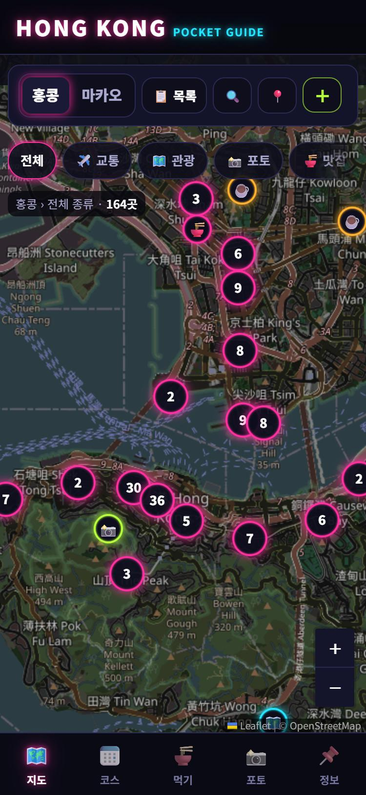

# Hong Kong Pocket Guide

홍콩·마카오를 직접 다녀오며 정리한 지도 가이드입니다.
맛집·카페·포토 스팟 194곳을 지도 하나에 모으고, 카드 결제가 되는지, 예약이 필요한지, 노을 때 어디서 찍으면 좋은지를 같이 적었습니다.
가이드에 없는 곳은 각자 **내 장소**로 추가해서 같은 지도에서 쓸 수 있습니다.

**페이지:** https://effortball-cloud.github.io/hk-guide/



## 들어 있는 것

| 탭 | 내용 |
|---|---|
| 🗺️ 지도 | 홍콩 164곳 · 마카오 30곳. 종류별 필터, 찜, 예약 필수·카드 안 됨·릴스 조건, 내 위치, ＋ 내 장소 추가 |
| 📅 코스 | 셩완 숙소 기준 4박 5일 예시 코스 (도착 · 노을 포토 · 마카오 당일치기 · 구룡 · 출국) |
| 🍜 먹기 | 맛집·카페·바 95곳. 동네·음식 종류·카드 결제·미쉐린으로 고르기 |
| 📸 포토 | 17:00~19:00 노을 시간에 맞춘 포토 동선 4가지 (스팟·시간대·이동 시간·근처 저녁) |
| 📌 정보 | 내가 추가한 장소 관리, 공항 → 시내, 환전·결제, 카드 안 되는 곳 32곳, 마카오 페리·돈 쓰는 법, 주의사항, 참고한 릴스 67개·후기 16개 |

폰에서 열고 **홈 화면에 추가**하면 앱처럼 쓸 수 있고, 한 번 열어 두면 데이터가 끊겨도 목록·코스·정보가 열립니다 (지도 바탕만 인터넷 필요).

## 내 장소 추가하기

가이드에 없는 맛집, 숙소, 친구가 알려 준 곳을 직접 넣을 수 있습니다.

1. 지도 탭 오른쪽 위 **＋** → 지도를 움직여 가운데 표시를 장소에 맞추고 **여기로**
2. 이름·종류·메모·카드 결제 여부를 적고 **저장**
3. 지도·먹기 탭에 가이드 장소와 같이 보입니다 (점선 테두리 핀, **✏️ 내 장소** 조건으로 따로 모아 보기)

- 저장은 **그 폰의 브라우저에만** 됩니다. 서버로 보내지 않습니다.
- 정보 탭 **내가 추가한 장소**에서 고치기·지우기, **파일로 내보내기 / 불러오기**를 할 수 있습니다. 폰을 바꾸거나 같이 여행하는 사람과 나눌 때 쓰세요.
- 내보낸 파일(JSON)의 `places` 항목은 `src/places.js`와 같은 필드라서, 이 저장소를 Fork해 쓰는 분은 그대로 옮겨 넣어 자기 가이드의 정식 장소로 만들 수 있습니다.

## 로컬에서 보기

Node.js 18 이상이 있으면 됩니다. 설치할 패키지는 없습니다.

```bash
node build.mjs          # src/ → dist/ (한 파일 index.html + 아이콘 + 오프라인 캐시)
cd dist && python -m http.server 8000
# http://localhost:8000
```

## 정보 고치기

| 파일 | 내용 |
|---|---|
| `src/places.js` | 장소 한 줄에 한 곳. 필드 설명은 파일 맨 위 주석 |
| `src/data_extra.js` | 동네, 예시 코스, 포토 동선, 정보 카드, 릴스·후기 링크 |
| `geo.json` | 장소 좌표 (`places.js`에 `ll`이 없을 때 씀) |

자주 쓰는 장소 필드: `n` 이름 · `l` 현지명 · `c` 종류(food·cafe·bar·photo·sight·shop·move) · `a` 동네 · `ad` 주소 · `h` 영업 · `p` 1인 예산(HKD) · `m` 메뉴 · `cd` 카드 결제(true / false / "?") · `pay` 결제 수단 · `rv` 예약 · `t` 팁 · `s` 출처(숫자 = 릴스 번호)

틀린 정보나 폐업한 곳은 [Issues](https://github.com/effortball-cloud/hk-guide/issues)로 알려 주세요. 직접 고쳐서 Pull Request를 보내셔도 됩니다.

## 내 버전으로 쓰기

1. 이 저장소를 Fork
2. `src/` 데이터를 원하는 대로 수정
3. 저장소 **Settings → Pages → Source**를 **GitHub Actions**로 바꾸기
4. `main`에 push하면 `.github/workflows/pages.yml`이 빌드해서 `https://<내 아이디>.github.io/hk-guide/`에 올립니다

## 출처와 라이선스

- 코드: [MIT](LICENSE)
- 가이드 글·장소 데이터(`src/places.js`, `src/data_extra.js`, `geo.json`): [CC BY 4.0](https://creativecommons.org/licenses/by/4.0/) — 출처만 밝히면 자유롭게 쓸 수 있습니다
- 지도: © [OpenStreetMap](https://www.openstreetmap.org/copyright) 기여자 · 지도 라이브러리 [Leaflet](https://leafletjs.com/)
- 인스타그램 릴스·블로그·유튜브는 **링크와 계정명만** 적었고, 영상·사진·글 원문은 싣지 않았습니다. 각 게시물의 권리는 원작자에게 있습니다. 링크 삭제를 원하시면 Issues에 남겨 주세요. 바로 지우겠습니다.
- 결제 정보는 OpenRice·구글맵 표시와 현장 확인을 바탕으로 했고 2026년 10월 기준입니다.

## 알아 두세요

직접 다녀오며 모은 기록이라 영업시간·가격·결제 방법은 바뀔 수 있으니 중요한 곳은 가기 전에 한 번 더 확인해 주세요.

만든 사람: hwarang
